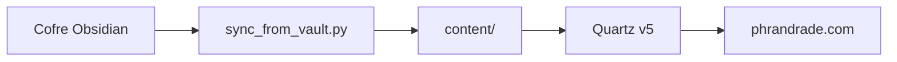

# quartz-site

[](https://github.com/pedroiff0/quartz-site/actions/workflows/ci.yml) [](LICENSE) [](https://github.com/pedroiff0/quartz-site/stargazers) [](#status-e-próximos-passos)

Jardim digital e portfólio acadêmico de Pedro Henrique Rocha de Andrade, publicado em [phrandrade.com](https://www.phrandrade.com) com Quartz v5 e sincronizado com o cofre Obsidian.

Este projeto faz parte do [portfólio](https://portfolio.phrandrade.com/#quartz-site) de Pedro Rocha.

## Sumário

- [Por que existe](#por-que-existe)
- [Funcionalidades](#funcionalidades)
- [Tecnologias](#tecnologias)
- [Instalação](#instalação)
- [Como usar](#como-usar)
- [Personalização](#personalização)
- [Como funciona](#como-funciona)
- [Trabalhando no projeto](#trabalhando-no-projeto)
- [Status e próximos passos](#status-e-próximos-passos)
- [Contribuindo e suporte](#contribuindo-e-suporte)
- [Estrelas e atividade](#estrelas-e-atividade)
- [Autor](#autor)
- [Licença](#licença)

## Por que existe

Notas, pesquisas e projetos vivem no cofre Obsidian, que é privado. O site publica só o que foi marcado para isso, com a mesma estrutura, em vários idiomas, sem copiar arquivos à mão.

## Funcionalidades

- Português como idioma principal e traduções em inglês, espanhol e francês, com alternador por slug.
- Hub acadêmico com disciplinas e notas de aula por período.
- Diagramas Mermaid e fórmulas KaTeX com tema claro e escuro.
- Datas localizadas por idioma e modo leitor.
- Sincronização do cofre por `tools/sync_from_vault.py`, que higieniza links, resolve consultas Dataview e normaliza tags.

## Tecnologias

      

## Instalação

### Pré-requisitos

- Node.js 18 ou superior.
- Python 3.10 ou superior (scripts de sincronização).

### Passos

```bash
git clone https://github.com/pedroiff0/quartz-site.git
cd quartz-site
npm install
```

### Conferindo

```bash
npm run check
```

Saída esperada: verificação de tipos e formatação sem erros.

## Como usar

### Uso básico

```bash
npx quartz build --serve
```

Abra `http://localhost:8080`.

### Exemplos

| Quero | Comando |
| :--- | :--- |
| Sincronizar o conteúdo do cofre | `python3 tools/sync_from_vault.py` |
| Rodar o site local | `npx quartz build --serve` |
| Verificar tipos e formato | `npm run check` |
| Formatar com Prettier | `npm run format` |
| Rodar os testes | `npm test` |

## Personalização

| Opção | Onde | Padrão | O que muda |
| :--- | :--- | :--- | :--- |
| Plugins, tema e layout | `quartz.config.yaml` | tema do site | Aparência e comportamento |
| Componentes | `quartz/components/` | rodapé, data, modo leitor | Interface |
| Estilos | `quartz/styles/` | SCSS global | Visual |

## Como funciona

O conteúdo de `content/` vem do cofre: o motor de sincronização do cofre copia só as notas marcadas para publicação, e o Quartz gera o site estático, publicado pelo GitHub Pages.



Estrutura: `content/` (pt-br, en, es, fr, assets), `quartz/` (motor, componentes e estilos), `tools/` (sincronização).

## Trabalhando no projeto

```bash
npm install
npm run check
npm test
```

1. Crie uma branch a partir de `main`: `git checkout -b feat/<assunto-curto>`.
2. Commits no padrão [Conventional Commits](https://www.conventionalcommits.org/pt-br/).
3. Não edite `content/` à mão: a fonte é o cofre.
4. Registre a mudança na seção `Unreleased` de [CHANGELOG.md](CHANGELOG.md).

## Status e próximos passos

Estado atual: **ativo**.

- [x] Site multilíngue com sincronização do cofre
- [x] Publicação automática no GitHub Pages
- [ ] Revisar traduções em espanhol e francês

## Contribuindo e suporte

Issues e pull requests são bem-vindos: veja [CONTRIBUTING.md](CONTRIBUTING.md), [CODE_OF_CONDUCT.md](CODE_OF_CONDUCT.md) e [SUPPORT.md](SUPPORT.md). Vulnerabilidades seguem [SECURITY.md](SECURITY.md).

## Estrelas e atividade

[](https://star-history.com/#pedroiff0/quartz-site&Date)

[](https://github.com/pedroiff0/quartz-site/graphs/commit-activity) [](https://github.com/pedroiff0/quartz-site/commits) [](https://github.com/pedroiff0/quartz-site/issues) [](https://github.com/pedroiff0/quartz-site/pulls)

## Autor

<table>
  <tr>
    <td align="center"><a href="https://github.com/pedroiff0"><br /><sub><b>Pedro Henrique Rocha de Andrade</b></sub></a><br />Autor e mantenedor</td>
  </tr>
</table>

### Contribuidores

[](https://github.com/pedroiff0/quartz-site/graphs/contributors)

## Licença

MIT. Veja [LICENSE](LICENSE).

Pedro Henrique Rocha de Andrade, 2026.
