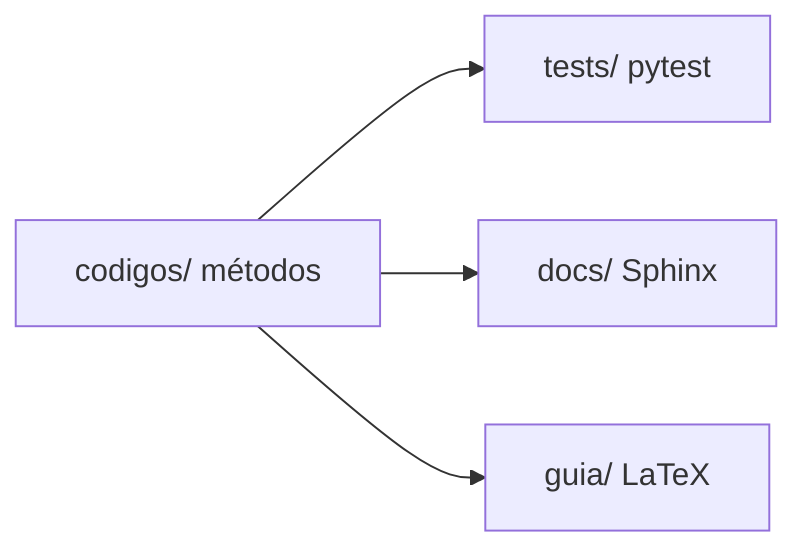

<div class="academic-nav-container">

<div class="academic-nav-breadcrumb">

<span>Projetos Públicos</span> <span class="academic-nav-sep">/</span> <span class="academic-nav-current-leaf">Cálculo Numérico</span>

</div>

<div class="academic-nav-controls">

<div class="academic-nav-side">

<span class="academic-nav-btn">[[pt-br/projects/personal/baton/index|← Baton]]</span>

</div>

<div class="academic-nav-center">

<span class="academic-nav-btn">Hub</span> <span class="academic-nav-counter">(4 de 10)</span>

</div>

<div class="academic-nav-side">

<span class="academic-nav-btn">[[pt-br/projects/personal/devops-guide/index|Guia de DevOps e Infraestrutura →]]</span>

</div>

</div>

</div>

# Cálculo Numérico

[](https://github.com/pedroiff0/calculo-numerico/actions/workflows/ci.yml)
[](LICENSE.md)
[](https://github.com/pedroiff0/calculo-numerico/stargazers)
[](#status)

Implementação em Python dos algoritmos da disciplina de Cálculo Numérico (2025.2, IFF Bom Jesus do Itabapoana), com 96 testes unitários, documentação Sphinx e um guia em LaTeX.

Este projeto faz parte do [portfólio](https://portfolio.phrandrade.com/#calculo-numerico) de Pedro Rocha.

## Sumário

- [Resumo](#resumo)
- [Contexto](#contexto)
- [Tecnologias](#tecnologias)
- [Começando](#começando)
- [Como usar](#como-usar)
- [Reprodução dos resultados](#reprodução-dos-resultados)
- [Metodologia](#metodologia)
- [Dados](#dados)
- [Estrutura do repositório](#estrutura-do-repositório)
- [Trabalhando no projeto](#trabalhando-no-projeto)
- [Status](#status)
- [Como citar](#como-citar)
- [Autores](#autores)
- [Licença](#licença)

## Resumo

Os métodos numéricos da disciplina costumam ser vistos em planilhas e códigos soltos, difíceis de comparar e de testar. Este repositório implementa os tópicos da ementa como biblioteca Python, com testes que verificam cada método contra soluções conhecidas e documentação técnica gerada com Sphinx. Os métodos cobrem erros de ponto flutuante, raízes de equações, interpolação, ajuste de curvas, integração, sistemas lineares e equações diferenciais ordinárias. Limitação: o foco é didático, sem otimização de desempenho.

## Contexto

Projeto da disciplina de Cálculo Numérico, semestre 2025.2, curso de Engenharia de Computação, Instituto Federal Fluminense, campus Bom Jesus do Itabapoana, com o professor Rodrigo Lacerda da Silva.

### Objetivos

- Implementar os algoritmos numéricos fundamentais em Python.
- Manter uma biblioteca testada e documentada.
- Demonstrar aplicações práticas dos métodos.

## Tecnologias

## Tecnologias

## Começando

### Pré-requisitos

- Python 3.8 ou superior.
- NumPy, SymPy, Matplotlib e SciPy (instalados pelo `pip`).
- Opcional: TeX Live para o guia em `guia/`.

### Instalação

```bash
git clone https://github.com/pedroiff0/calculo-numerico.git
cd calculo-numerico
make install
```

### Conferindo que funcionou

```bash
make test
```

Saída esperada: 96 testes aprovados.

## Como usar

### Exemplo 1: método da bisseção

```python
from codigos.raizes import bissecao

raiz, iteracoes = bissecao("x**2 - 2", 1, 2, 1e-8, 100)
print(raiz)
```

Saída esperada: aproximadamente `1.41421356`.

### Opções principais

| Comando | Efeito |
| :--- | :--- |
| `make test` | Roda a suíte pytest |
| `make docs` | Gera a documentação Sphinx em HTML |
| `make lint` | Verifica a sintaxe Python |
| `make clean` | Remove caches e builds temporários |

## Reprodução dos resultados

| Resultado | Comando |
| :--- | :--- |
| Testes unitários | `pytest tests/ -v` |
| Documentação HTML | `make docs` |
| Guia em PDF | `cd guia && make book` |

Versões fixadas em `pyproject.toml`.

## Metodologia

Cada tópico da ementa é um módulo em `codigos/`, com testes em `tests/` que comparam o resultado com soluções analíticas ou valores de referência.



## Dados

Não há conjuntos de dados externos: os exemplos usam funções e sistemas definidos nos próprios testes e na documentação.

## Estrutura do repositório

```text
calculo-numerico/
├── codigos/       implementação dos métodos
├── tests/         suíte pytest
├── docs/          documentação Sphinx
├── guia/          guia em LaTeX
└── pyproject.toml pacote e dependências
```

## Trabalhando no projeto

### Ambiente de desenvolvimento

```bash
make install
make test
```

### Fluxo de trabalho

1. Crie uma branch a partir de `main`: `git checkout -b feat/<assunto-curto>`.
2. Commits no padrão [Conventional Commits](https://www.conventionalcommits.org/pt-br/).
3. Rode `make test` antes de abrir o pull request.
4. Registre a mudança na seção `Unreleased` de [CHANGELOG.md](CHANGELOG.md).

### Convenções

Funções documentadas com docstring, um teste por método e nomes em português.

## Status

Estado atual: **concluído** para a disciplina; mantido para consulta e correções.

- [x] Todos os tópicos da ementa implementados e testados
- [x] Documentação Sphinx e guia em LaTeX
- [ ] Publicar o pacote no PyPI

## Como citar

Use o arquivo [CITATION.cff](CITATION.cff) (botão "Cite this repository" do GitHub).

## Autores

## Licença

MIT. Veja [LICENSE](LICENSE.md).

Pedro Henrique Rocha de Andrade, 2026.
