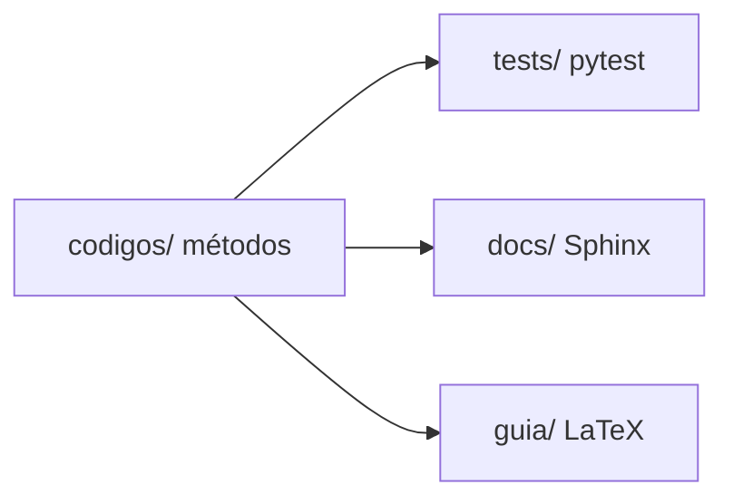

<div class="academic-nav-container">

<div class="academic-nav-breadcrumb">

<span>Projetos Públicos</span> <span class="academic-nav-sep">/</span> <span class="academic-nav-current-leaf">Cálculo Numérico</span>

</div>

<div class="academic-nav-controls">

<div class="academic-nav-side">

<span class="academic-nav-btn">[[pt-br/projects/personal/baton/index|← Baton]]</span>

</div>

<div class="academic-nav-center">

<span class="academic-nav-btn">Hub</span> <span class="academic-nav-counter">(4 de 10)</span>

</div>

<div class="academic-nav-side">

<span class="academic-nav-btn">[[pt-br/projects/personal/devops-guide/index|Guia de DevOps e Infraestrutura →]]</span>

</div>

</div>

</div>

# Cálculo Numérico

[](https://github.com/pedroiff0/calculo-numerico/actions/workflows/ci.yml) [](https://github.com/pedroiff0/calculo-numerico/blob/HEAD/LICENSE.md) [](https://github.com/pedroiff0/calculo-numerico/stargazers) [](#status)

Implementação em Python dos algoritmos da disciplina de Cálculo Numérico (2025.2, IFF Bom Jesus do Itabapoana), com 96 testes unitários, documentação Sphinx e um guia em LaTeX.

Este projeto faz parte do [portfólio](https://portfolio.phrandrade.com/#calculo-numerico) de Pedro Rocha.

## Sumário

- [Resumo](#resumo)
- [Contexto](#contexto)
- [Tecnologias](#tecnologias)
- [Começando](#começando)
- [Como usar](#como-usar)
- [Reprodução dos resultados](#reprodução-dos-resultados)
- [Metodologia](#metodologia)
- [Dados](#dados)
- [Estrutura do repositório](#estrutura-do-repositório)
- [Trabalhando no projeto](#trabalhando-no-projeto)
- [Status](#status)
- [Como citar](#como-citar)
- [Como contribuir](#como-contribuir)
- [Código de conduta](#código-de-conduta)
- [Segurança](#segurança)
- [Suporte](#suporte)
- [Estrelas e atividade](#estrelas-e-atividade)
- [Autor](#autor)
- [Contribuidores](#contribuidores)
- [Licença](#licença)

## Resumo

Os métodos numéricos da disciplina costumam ser vistos em planilhas e códigos soltos, difíceis de comparar e de testar. Este repositório implementa os tópicos da ementa como biblioteca Python, com testes que verificam cada método contra soluções conhecidas e documentação técnica gerada com Sphinx. Os métodos cobrem erros de ponto flutuante, raízes de equações, interpolação, ajuste de curvas, integração, sistemas lineares e equações diferenciais ordinárias. Limitação: o foco é didático, sem otimização de desempenho.

## Contexto

Projeto da disciplina de Cálculo Numérico, semestre 2025.2, curso de Engenharia de Computação, Instituto Federal Fluminense, campus Bom Jesus do Itabapoana, com o professor Rodrigo Lacerda da Silva.

### Objetivos

- Implementar os algoritmos numéricos fundamentais em Python.
- Manter uma biblioteca testada e documentada.
- Demonstrar aplicações práticas dos métodos.

## Tecnologias

       

## Começando

### Pré-requisitos

- Python 3.8 ou superior.
- NumPy, SymPy, Matplotlib e SciPy (instalados pelo `pip`).
- Opcional: TeX Live para o guia em `guia/`.

### Instalação

```bash
git clone https://github.com/pedroiff0/calculo-numerico.git
cd calculo-numerico
make install
```

### Conferindo que funcionou

```bash
make test
```

Saída esperada: 96 testes aprovados.

## Como usar

### Exemplo 1: método da bisseção

```python
from codigos.raizes import bissecao

raiz, iteracoes = bissecao("x**2 - 2", 1, 2, 1e-8, 100)
print(raiz)
```

Saída esperada: aproximadamente `1.41421356`.

### Opções principais

| Comando | Efeito |
| :--- | :--- |
| `make test` | Roda a suíte pytest |
| `make docs` | Gera a documentação Sphinx em HTML |
| `make lint` | Verifica a sintaxe Python |
| `make clean` | Remove caches e builds temporários |

## Reprodução dos resultados

| Resultado | Comando |
| :--- | :--- |
| Testes unitários | `pytest tests/ -v` |
| Documentação HTML | `make docs` |
| Guia em PDF | `cd guia && make book` |

Versões fixadas em `pyproject.toml`.

## Metodologia

Cada tópico da ementa é um módulo em `codigos/`, com testes em `tests/` que comparam o resultado com soluções analíticas ou valores de referência.



## Dados

Não há conjuntos de dados externos: os exemplos usam funções e sistemas definidos nos próprios testes e na documentação.

## Estrutura do repositório

```text
calculo-numerico/
├── codigos/       implementação dos métodos
├── tests/         suíte pytest
├── docs/          documentação Sphinx
├── guia/          guia em LaTeX
└── pyproject.toml pacote e dependências
```

## Trabalhando no projeto

### Ambiente de desenvolvimento

```bash
make install
make test
```

### Fluxo de trabalho

1. Crie uma branch a partir de `main`: `git checkout -b feat/<assunto-curto>`.
2. Commits no padrão [Conventional Commits](https://www.conventionalcommits.org/pt-br/).
3. Rode `make test` antes de abrir o pull request.
4. Registre a mudança na seção `Unreleased` de [CHANGELOG.md](https://github.com/pedroiff0/calculo-numerico/blob/HEAD/CHANGELOG.md).

### Convenções

Funções documentadas com docstring, um teste por método e nomes em português.

## Status

Estado atual: **concluído** para a disciplina; mantido para consulta e correções.

- [x] Todos os tópicos da ementa implementados e testados
- [x] Documentação Sphinx e guia em LaTeX
- [ ] Publicar o pacote no PyPI

## Como citar

Use o arquivo [CITATION.cff](https://github.com/pedroiff0/calculo-numerico/blob/HEAD/CITATION.cff) (botão "Cite this repository" do GitHub).

## Como contribuir

Contribuições são bem-vindas. Antes de começar, leia o [guia de contribuição](https://github.com/pedroiff0/calculo-numerico/blob/HEAD/CONTRIBUTING.md).

1. Abra uma issue descrevendo o problema ou a ideia.
2. Crie uma branch a partir de `main`: `git checkout -b feat/<assunto-curto>`.
3. Faça commits no padrão [Conventional Commits](https://www.conventionalcommits.org/pt-br/).
4. Abra o pull request e registre a mudança em [CHANGELOG.md](https://github.com/pedroiff0/calculo-numerico/blob/HEAD/CHANGELOG.md).

## Código de conduta

Este projeto adota o [Código de Conduta](https://github.com/pedroiff0/calculo-numerico/blob/HEAD/CODE_OF_CONDUCT.md). Ao participar, você concorda em segui-lo.

## Segurança

Não abra issue pública para vulnerabilidades. Siga o procedimento de [SECURITY.md](https://github.com/pedroiff0/calculo-numerico/blob/HEAD/SECURITY.md) para reportar de forma confidencial.

## Suporte

Dúvidas e pedidos de ajuda: veja [SUPPORT.md](https://github.com/pedroiff0/calculo-numerico/blob/HEAD/SUPPORT.md).

## Estrelas e atividade

[](https://star-history.com/#pedroiff0/calculo-numerico&Date)

[](https://github.com/pedroiff0/calculo-numerico/graphs/commit-activity) [](https://github.com/pedroiff0/calculo-numerico/commits) [](https://github.com/pedroiff0/calculo-numerico/issues) [](https://github.com/pedroiff0/calculo-numerico/pulls)

<div align="center">

## Autor

<table>
  <tr>
    <td align="center"><a href="https://github.com/pedroiff0"><br /><sub><b>Pedro Henrique Rocha de Andrade</b></sub></a><br />Autor e mantenedor</td>
  </tr>
</table>

## Contribuidores

[](https://github.com/pedroiff0/calculo-numerico/graphs/contributors)

</div>

## Licença

Distribuído sob a licença MIT. Texto completo do arquivo [LICENSE](https://github.com/pedroiff0/calculo-numerico/blob/HEAD/LICENSE.md):

```txt
MIT License

Copyright (c) <2025> <Pedro Henrique Rocha de Andrade>

Permission is hereby granted, free of charge, to any person obtaining a copy
of this software and associated documentation files (the "Software"), to deal
in the Software without restriction, including without limitation the rights
to use, copy, modify, merge, publish, distribute, sublicense, and/or sell
copies of the Software, and to permit persons to whom the Software is
furnished to do so, subject to the following conditions:

[Full MIT license text omitted here for brevity — include the standard MIT text in the file before publishing.]
```

---

<div align="center">

 *"Keep looking up."*


<br>

<sub>© 2026 Pedro Rocha — Computer Engineering & Computational Astrophysics · IFF / PIBIC-CNPq, made with ☕, code and ☄️ by Pedro Henrique Rocha de Andrade</sub>

</div>
