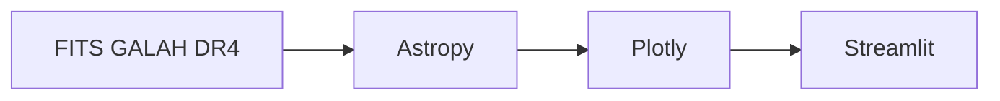

<div class="academic-nav-container">

<div class="academic-nav-breadcrumb">

<span>Projetos Públicos</span> <span class="academic-nav-sep">/</span> <span class="academic-nav-current-leaf">SpectraViewer</span>

</div>

<div class="academic-nav-controls">

<div class="academic-nav-side">

<span class="academic-nav-btn">[[pt-br/projects/professional/projeto-profissional/index|← Projeto Profissional (template)]]</span>

</div>

<div class="academic-nav-center">

<span class="academic-nav-btn">Hub</span> <span class="academic-nav-counter">(10 de 10)</span>

</div>

<div class="academic-nav-side">

<span class="academic-nav-btn is-disabled">Fim →</span>

</div>

</div>

</div>

# SpectraViewer

[](https://github.com/pedroiff0/spectraviewer/actions/workflows/ci.yml) [](https://github.com/pedroiff0/spectraviewer/blob/HEAD/LICENSE) [](https://github.com/pedroiff0/spectraviewer/stargazers) [](#status)

Visualizador interativo de espectros estelares do catálogo GALAH DR4 (Galactic Archaeology with HERMES), com as quatro bandas, linhas espectrais de referência e metadados estelares.

Este projeto faz parte do [portfólio](https://portfolio.phrandrade.com/#spectraviewer) de Pedro Rocha.

## Sumário

- [Resumo](#resumo)
- [Contexto](#contexto)
- [Tecnologias](#tecnologias)
- [Começando](#começando)
- [Como usar](#como-usar)
- [Reprodução dos resultados](#reprodução-dos-resultados)
- [Metodologia](#metodologia)
- [Dados](#dados)
- [Estrutura do repositório](#estrutura-do-repositório)
- [Trabalhando no projeto](#trabalhando-no-projeto)
- [Status](#status)
- [Como citar](#como-citar)
- [Autor](#autor)
- [Licença](#licença)

## Resumo

Inspecionar espectros do GALAH DR4 exige abrir arquivos FITS um a um, e a identificação de linhas é manual. O SpectraViewer lê os FITS locais, plota as quatro bandas do HERMES (azul, verde, vermelha e infravermelha), sobrepõe grupos de linhas de referência (CNO, processo alfa, pico do ferro) e mostra Teff, log g, [Fe/H] e outras abundâncias da estrela escolhida. Limitação: depende dos arquivos FITS locais, que não são redistribuídos integralmente.

## Contexto

Ferramenta de apoio à pesquisa em arqueologia galáctica, usada para inspecionar visualmente estrelas candidatas do GALAH DR4.

### Objetivos

- Explorar espectros de forma interativa, sem scripts ad hoc.
- Conferir linhas e abundâncias de uma estrela em uma tela.

## Tecnologias

## Tecnologias


## Começando

### Pré-requisitos

- Python 3.8 ou superior.
- Arquivos FITS do GALAH DR4 (amostras incluídas em `spectra/`).

### Instalação

```bash
git clone https://github.com/pedroiff0/spectraviewer.git
cd spectraviewer
python3 -m venv venv
source venv/bin/activate
pip install -r requirements.txt
```

### Conferindo que funcionou

```bash
streamlit run spectraviewer.py
```

Saída esperada: o aplicativo abre em `http://localhost:8501`.

## Como usar

### Exemplo 1: ver o espectro de uma estrela

1. Escolha a estrela no menu.
2. O espectro das quatro bandas é carregado.
3. Marque os grupos de linhas a sobrepor.
4. Ative "Show line labels" para ver a identificação das linhas.

### Opções principais

| Opção | Efeito |
| :--- | :--- |
| Seleção de estrela | Carrega os FITS das quatro CCDs |
| Grupos de linhas | Sobrepõe CNO, processo alfa, pico do ferro e outros |
| Rótulos | Mostra a identificação de cada linha |

## Reprodução dos resultados

O aplicativo é determinístico: a mesma estrela e os mesmos FITS geram o mesmo gráfico. Dependências fixadas em `requirements.txt`.

## Metodologia

Os espectros são lidos com Astropy, organizados por CCD e plotados com Plotly dentro do Streamlit.



## Dados

| Item | Local |
| :--- | :--- |
| Espectros | `spectra/galah/dr4/spectra/hermes/com/{AAMMDD}/{sobject_id}{CCD}.fits` |
| Bandas | CCD 1 azul (~4713 Å), 2 verde (~5648 Å), 3 vermelha (~6478 Å), 4 infravermelha (~7585 Å) |
| Metadados | `TEFF_R`, `LOGG_R`, `FE_H_R`, `A_FE_R`, `SNR_AA`, `RV`, `E_RV` |
| Catálogo de classes | `class.txt` |

O GALAH DR4 completo é obtido em [galah-survey.org](https://www.galah-survey.org/).

## Estrutura do repositório

```text
spectraviewer/
├── spectraviewer.py   aplicativo Streamlit
├── requirements.txt   dependências
├── class.txt          catálogo de classificação espectral
└── spectra/           amostras de espectros FITS
```

## Trabalhando no projeto

### Ambiente de desenvolvimento

```bash
python3 -m venv venv && source venv/bin/activate
pip install -r requirements.txt
```

### Fluxo de trabalho

1. Crie uma branch a partir de `main`: `git checkout -b feat/<assunto-curto>`.
2. Commits no padrão [Conventional Commits](https://www.conventionalcommits.org/pt-br/).
3. Teste com ao menos uma estrela de amostra antes do pull request.
4. Registre a mudança na seção `Unreleased` de [CHANGELOG.md](https://github.com/pedroiff0/spectraviewer/blob/HEAD/CHANGELOG).

### Convenções

Código em Python com nomes em inglês e documentação em português.

## Status

Estado atual: **ativo**.

- [x] Visualização das quatro bandas e linhas de referência
- [ ] Exportar o gráfico e a lista de linhas
- [ ] Comparar duas estrelas lado a lado

## Como citar

Use o arquivo [CITATION.cff](CITATION.cff) (botão "Cite this repository" do GitHub). Cite também o GALAH DR4 (Buder et al.).

## Autor

<table>
  <tr>
    <td align="center"><a href="https://github.com/pedroiff0"><br /><sub><b>Pedro Henrique Rocha de Andrade</b></sub></a><br />Autor e mantenedor</td>
  </tr>
</table>

### Contribuidores

[](https://github.com/pedroiff0/spectraviewer/graphs/contributors)

## Licença

MIT. Veja [LICENSE](https://github.com/pedroiff0/spectraviewer/blob/HEAD/LICENSE).

Pedro Henrique Rocha de Andrade, 2026.
