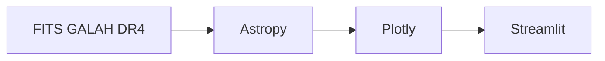

<div class="academic-nav-container">

<div class="academic-nav-breadcrumb">

<span>Projetos Públicos</span> <span class="academic-nav-sep">/</span> <span class="academic-nav-current-leaf">SpectraViewer</span>

</div>

<div class="academic-nav-controls">

<div class="academic-nav-side">

<span class="academic-nav-btn">[[pt-br/projects/professional/projeto-profissional/index|← Projeto Profissional (template)]]</span>

</div>

<div class="academic-nav-center">

<span class="academic-nav-btn">Hub</span> <span class="academic-nav-counter">(10 de 10)</span>

</div>

<div class="academic-nav-side">

<span class="academic-nav-btn is-disabled">Fim →</span>

</div>

</div>

</div>

# SpectraViewer

[](https://github.com/pedroiff0/spectraviewer/actions/workflows/ci.yml) [](https://github.com/pedroiff0/spectraviewer/blob/HEAD/LICENSE.md) [](https://github.com/pedroiff0/spectraviewer/stargazers) [](#status)

Visualizador interativo de espectros estelares do catálogo GALAH DR4 (Galactic Archaeology with HERMES), com as quatro bandas, linhas espectrais de referência e metadados estelares.

Este projeto faz parte do [portfólio](https://portfolio.phrandrade.com/#spectraviewer) de Pedro Rocha.

## Sumário

- [Resumo](#resumo)
- [Contexto](#contexto)
- [Tecnologias](#tecnologias)
- [Começando](#começando)
- [Como usar](#como-usar)
- [Reprodução dos resultados](#reprodução-dos-resultados)
- [Metodologia](#metodologia)
- [Dados](#dados)
- [Estrutura do repositório](#estrutura-do-repositório)
- [Trabalhando no projeto](#trabalhando-no-projeto)
- [Status](#status)
- [Como citar](#como-citar)
- [Como contribuir](#como-contribuir)
- [Código de conduta](#código-de-conduta)
- [Segurança](#segurança)
- [Suporte](#suporte)
- [Estrelas e atividade](#estrelas-e-atividade)
- [Autor](#autor)
- [Contribuidores](#contribuidores)
- [Licença](#licença)

## Resumo

Inspecionar espectros do GALAH DR4 exige abrir arquivos FITS um a um, e a identificação de linhas é manual. O SpectraViewer lê os FITS locais, plota as quatro bandas do HERMES (azul, verde, vermelha e infravermelha), sobrepõe grupos de linhas de referência (CNO, processo alfa, pico do ferro) e mostra Teff, log g, [Fe/H] e outras abundâncias da estrela escolhida. Limitação: depende dos arquivos FITS locais, que não são redistribuídos integralmente.

## Contexto

Ferramenta de apoio à pesquisa em arqueologia galáctica, usada para inspecionar visualmente estrelas candidatas do GALAH DR4.

### Objetivos

- Explorar espectros de forma interativa, sem scripts ad hoc.
- Conferir linhas e abundâncias de uma estrela em uma tela.

## Tecnologias

   

## Começando

### Pré-requisitos

- Python 3.8 ou superior.
- Arquivos FITS do GALAH DR4 (amostras incluídas em `spectra/`).

### Instalação

```bash
git clone https://github.com/pedroiff0/spectraviewer.git
cd spectraviewer
python3 -m venv venv
source venv/bin/activate
pip install -r requirements.txt
```

### Conferindo que funcionou

```bash
streamlit run spectraviewer.py
```

Saída esperada: o aplicativo abre em `http://localhost:8501`.

## Como usar

### Exemplo 1: ver o espectro de uma estrela

1. Escolha a estrela no menu.
2. O espectro das quatro bandas é carregado.
3. Marque os grupos de linhas a sobrepor.
4. Ative "Show line labels" para ver a identificação das linhas.

### Opções principais

| Opção | Efeito |
| :--- | :--- |
| Seleção de estrela | Carrega os FITS das quatro CCDs |
| Grupos de linhas | Sobrepõe CNO, processo alfa, pico do ferro e outros |
| Rótulos | Mostra a identificação de cada linha |

## Reprodução dos resultados

O aplicativo é determinístico: a mesma estrela e os mesmos FITS geram o mesmo gráfico. Dependências fixadas em `requirements.txt`.

## Metodologia

Os espectros são lidos com Astropy, organizados por CCD e plotados com Plotly dentro do Streamlit.



## Dados

| Item | Local |
| :--- | :--- |
| Espectros | `spectra/galah/dr4/spectra/hermes/com/{AAMMDD}/{sobject_id}{CCD}.fits` |
| Bandas | CCD 1 azul (~4713 Å), 2 verde (~5648 Å), 3 vermelha (~6478 Å), 4 infravermelha (~7585 Å) |
| Metadados | `TEFF_R`, `LOGG_R`, `FE_H_R`, `A_FE_R`, `SNR_AA`, `RV`, `E_RV` |
| Catálogo de classes | `class.txt` |

O GALAH DR4 completo é obtido em [galah-survey.org](https://www.galah-survey.org/).

## Estrutura do repositório

```text
spectraviewer/
├── spectraviewer.py   aplicativo Streamlit
├── requirements.txt   dependências
├── class.txt          catálogo de classificação espectral
└── spectra/           amostras de espectros FITS
```

## Trabalhando no projeto

### Ambiente de desenvolvimento

```bash
python3 -m venv venv && source venv/bin/activate
pip install -r requirements.txt
```

### Fluxo de trabalho

1. Crie uma branch a partir de `main`: `git checkout -b feat/<assunto-curto>`.
2. Commits no padrão [Conventional Commits](https://www.conventionalcommits.org/pt-br/).
3. Teste com ao menos uma estrela de amostra antes do pull request.
4. Registre a mudança na seção `Unreleased` de [CHANGELOG.md](https://github.com/pedroiff0/spectraviewer/blob/HEAD/CHANGELOG.md).

### Convenções

Código em Python com nomes em inglês e documentação em português.

## Status

Estado atual: **ativo**.

- [x] Visualização das quatro bandas e linhas de referência
- [ ] Exportar o gráfico e a lista de linhas
- [ ] Comparar duas estrelas lado a lado

## Como citar

Use o arquivo [CITATION.cff](https://github.com/pedroiff0/spectraviewer/blob/HEAD/CITATION.cff) (botão "Cite this repository" do GitHub). Cite também o GALAH DR4 (Buder et al.).

## Como contribuir

Contribuições são bem-vindas. Antes de começar, leia o [guia de contribuição](https://github.com/pedroiff0/spectraviewer/blob/HEAD/CONTRIBUTING.md).

1. Abra uma issue descrevendo o problema ou a ideia.
2. Crie uma branch a partir de `main`: `git checkout -b feat/<assunto-curto>`.
3. Faça commits no padrão [Conventional Commits](https://www.conventionalcommits.org/pt-br/).
4. Abra o pull request e registre a mudança em [CHANGELOG.md](https://github.com/pedroiff0/spectraviewer/blob/HEAD/CHANGELOG.md).

## Código de conduta

Este projeto adota o [Código de Conduta](https://github.com/pedroiff0/spectraviewer/blob/HEAD/CODE_OF_CONDUCT.md). Ao participar, você concorda em segui-lo.

## Segurança

Não abra issue pública para vulnerabilidades. Siga o procedimento de [SECURITY.md](https://github.com/pedroiff0/spectraviewer/blob/HEAD/SECURITY.md) para reportar de forma confidencial.

## Suporte

Dúvidas e pedidos de ajuda: veja [SUPPORT.md](https://github.com/pedroiff0/spectraviewer/blob/HEAD/SUPPORT.md).

## Estrelas e atividade

[](https://star-history.com/#pedroiff0/spectraviewer&Date)

[](https://github.com/pedroiff0/spectraviewer/graphs/commit-activity) [](https://github.com/pedroiff0/spectraviewer/commits) [](https://github.com/pedroiff0/spectraviewer/issues) [](https://github.com/pedroiff0/spectraviewer/pulls)

<div align="center">

## Autor

<table>
  <tr>
    <td align="center"><a href="https://github.com/pedroiff0"><br /><sub><b>Pedro Henrique Rocha de Andrade</b></sub></a><br />Autor e mantenedor</td>
  </tr>
</table>

## Contribuidores

[](https://github.com/pedroiff0/spectraviewer/graphs/contributors)

</div>

## Licença

Distribuído sob a licença MIT. Texto completo do arquivo [LICENSE](https://github.com/pedroiff0/spectraviewer/blob/HEAD/LICENSE.md):

```txt
MIT License

Copyright (c) 2026 Pedro Henrique Ribeiro de Andrade

Permission is hereby granted, free of charge, to any person obtaining a copy
of this software and associated documentation files (the "Software"), to deal
in the Software without restriction, including without limitation the rights
to use, copy, modify, merge, publish, distribute, sublicense, and/or sell
copies of the Software, and to permit persons to whom the Software is
furnished to do so, subject to the following conditions:

The above copyright notice and this permission notice shall be included in all
copies or substantial portions of the Software.

THE SOFTWARE IS PROVIDED "AS IS", WITHOUT WARRANTY OF ANY KIND, EXPRESS OR
IMPLIED, INCLUDING BUT NOT LIMITED TO THE WARRANTIES OF MERCHANTABILITY,
FITNESS FOR A PARTICULAR PURPOSE AND NONINFRINGEMENT. IN NO EVENT SHALL THE
AUTHORS OR COPYRIGHT HOLDERS BE LIABLE FOR ANY CLAIM, DAMAGES OR OTHER
LIABILITY, WHETHER IN AN ACTION OF CONTRACT, TORT OR OTHERWISE, ARISING FROM,
OUT OF OR IN CONNECTION WITH THE SOFTWARE OR THE USE OR OTHER DEALINGS IN THE
SOFTWARE.
```

---

<div align="center">

 *"Keep looking up."*


<br>

<sub>© 2026 Pedro Rocha — Computer Engineering & Computational Astrophysics · IFF / PIBIC-CNPq, made with ☕, code and ☄️ by Pedro Henrique Rocha de Andrade</sub>

</div>
