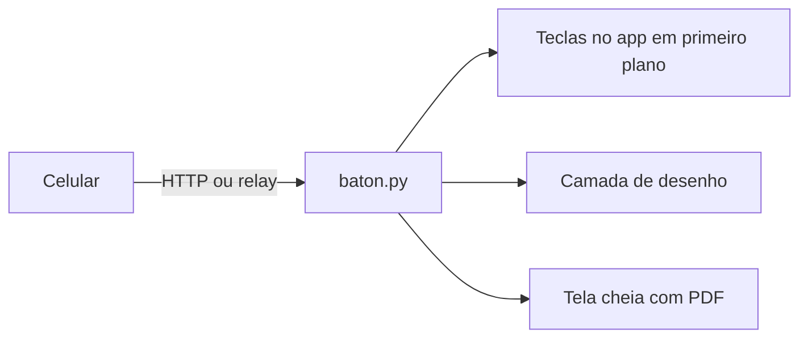

<div class="academic-nav-container">

<div class="academic-nav-breadcrumb">

<span>Projetos Públicos</span> <span class="academic-nav-sep">/</span> <span class="academic-nav-current-leaf">Baton</span>

</div>

<div class="academic-nav-controls">

<div class="academic-nav-side">

<span class="academic-nav-btn">[[pt-br/projects/academic/anomaly-viewer/index|← Painel interativo de Detecção de Anomal…]]</span>

</div>

<div class="academic-nav-center">

<span class="academic-nav-btn">Hub</span> <span class="academic-nav-counter">(2 de 2)</span>

</div>

<div class="academic-nav-side">

<span class="academic-nav-btn is-disabled">Fim →</span>

</div>

</div>

</div>

# Baton

[](LICENSE.md)
[](https://github.com/pedroiff0/baton/stargazers)
[](#status-e-próximos-passos)

Passador de slides pelo celular: o iPhone ou Android controla qualquer app de apresentação no macOS, Windows ou Linux, com laser, foco, caneta, marca-texto, cortina, notas e zoom. Somente biblioteca padrão do Python 3.8+.

Este projeto faz parte do [portfólio](https://portfolio.phrandrade.com/#baton) de Pedro Rocha.

## Sumário

- [Por que existe](#por-que-existe)
- [Funcionalidades](#funcionalidades)
- [Tecnologias](#tecnologias)
- [Instalação](#instalação)
- [Como usar](#como-usar)
- [Personalização](#personalização)
- [Como funciona](#como-funciona)
- [Trabalhando no projeto](#trabalhando-no-projeto)
- [Status e próximos passos](#status-e-próximos-passos)
- [Contribuindo e suporte](#contribuindo-e-suporte)
- [Autores](#autores)
- [Licença](#licença)

## Por que existe

Passadores físicos não têm laser digital, notas nem cronômetro, e os apps de controle remoto dependem de conta, de nuvem ou de um software proprietário em cada computador. O Baton usa o navegador do celular, não instala nada nele e roda sem internet.

## Funcionalidades

- Modo externo: envia setas, Home e End ao app em primeiro plano e desenha laser, foco, caneta e marca-texto numa camada transparente, inclusive em tela cheia.
- Modo tela: exibe um PDF no navegador com transições, notas do apresentador, cronômetro com meta, prévia do próximo slide e "Ir para".
- Zoom de 1,5x a 5x sobre a projeção, cortina (preto, branco, teatro) e efeitos sonoros.
- Modo residente: detecta apresentação em tela cheia e pergunta no celular antes de enviar qualquer tecla.
- Relay opcional para várias sessões em paralelo, sem login e sem coleta de dados.
- Pareamento por QR code de uso único, um token por celular, funcionando por Wi-Fi, hotspot, Bluetooth (tethering) ou Tailscale.

## Tecnologias

## Tecnologias


## Instalação

### Pré-requisitos

- Python 3.8 ou superior.
- Celular e computador na mesma rede IP (Wi-Fi, hotspot ou Tailscale).

### Passos

```bash
git clone https://github.com/pedroiff0/baton.git
cd baton
./install.sh        # macOS e Linux, sem sudo
# Windows (PowerShell, sem administrador): .\install.ps1
```

### Conferindo

```bash
python3 baton.py --diagnostico
```

Saída esperada: resumo com sistema, backend de teclas, camada de desenho e porta do servidor local.

## Como usar

### Uso básico

```bash
python3 baton.py                # celular controla o app em primeiro plano
python3 baton.py slides.pdf     # o Baton exibe o PDF no navegador
python3 baton.py --instalar     # inicia com o sistema (--desinstalar remove)
```

Ao iniciar, uma página local mostra um QR code: escaneie com o celular. No iPhone, Compartilhar > Adicionar à Tela de Início; no Android, menu > Instalar app.

### Exemplos

| Quero | Comando |
| :--- | :--- |
| Apresentar um PDF com notas | `python3 baton.py slides.pdf --notas slides.notas.md` |
| Controlar o PowerPoint com prévia e notas | `python3 baton.py apresentacao.pptx --externo` |
| Importar notas sem abrir o arquivo | `baton --importar-notas apresentacao.pptx` |
| Escolher o monitor da projeção | `baton --monitor 2` |
| Pausar sem desinstalar | `baton --pausar` e `baton --retomar` |
| Preparar tudo para uso sem internet | `baton --preparar-offline` |

## Personalização

| Opção | Onde | Padrão | O que muda |
| :--- | :--- | :--- | :--- |
| `--porta` | linha de comando | `8765` | Porta do servidor local |
| `--sem-overlay` | linha de comando | desligado | Desliga a camada de desenho |
| `--sem-relay-publico` | linha de comando | desligado | Não se registra no relay público |
| `--url-publica` | linha de comando | vazio | Endereço HTTPS de um túnel Cloudflare |
| Laser, foco, caneta | painel em `http://localhost:8765/painel` | cor e tamanhos padrão | Ajustes salvos em disco |

Valores sensíveis (chave do relay) ficam em variáveis de ambiente, nunca no Git.

## Como funciona

O `baton.py` sobe um servidor HTTP local que serve a página de controle ao celular e recebe os comandos. Os comandos viram teclas no app em primeiro plano, por backend de cada sistema (CoreGraphics, user32 ou xdotool), e eventos para a camada de desenho. Sem rede em comum, um relay encaminha o tráfego entre o celular e o computador.



Detalhes de plataformas, uso sem internet, relay e segurança em [documentação](https://github.com/pedroiff0/baton/blob/HEAD/CHANGELOG.md) e no vault do projeto.

## Trabalhando no projeto

```bash
python3 -m unittest discover -s tests -v
BATON_BACKEND=log BATON_OVERLAY=log python3 baton.py --sem-abrir
```

1. Crie uma branch a partir de `main`: `git checkout -b feat/<assunto-curto>`.
2. Commits no padrão [Conventional Commits](https://www.conventionalcommits.org/pt-br/).
3. Mantenha apenas a biblioteca padrão do Python e adicione testes em `tests/`.
4. Registre a mudança na seção `Não lançado` de [CHANGELOG.md](CHANGELOG.md).

## Status e próximos passos

Estado atual: **ativo**. A camada do macOS e o Windows ainda dependem de teste em máquina real; Wayland nativo não permite enviar teclas (use sessão X11).

- [x] Modo externo, modo tela, notas, zoom e relay
- [x] Pacote portátil para Windows e pen-drive multi-sistema
- [ ] Validar a camada de desenho no macOS e no Windows
- [ ] Suporte a Wayland nativo

## Contribuindo e suporte

Issues e pull requests são bem-vindos: veja [CONTRIBUTING.md](CONTRIBUTING.md), [CODE_OF_CONDUCT.md](CODE_OF_CONDUCT.md) e [SUPPORT.md](SUPPORT.md). Vulnerabilidades seguem [SECURITY.md](SECURITY.md).

## Autores

<table>
  <tr>
    <td align="center"><a href="https://github.com/pedroiff0"><br /><sub><b>Pedro Henrique Rocha de Andrade</b></sub></a><br />Autor e mantenedor</td>
  </tr>
</table>

### Contribuidores

[](https://github.com/pedroiff0/baton/graphs/contributors)

## Licença

MIT. Veja [LICENSE](LICENSE.md). O pdf.js (Apache-2.0) e o qrcode-generator (MIT) vêm de `vendor/` com as licenças originais.

Pedro Henrique Rocha de Andrade, 2026.
