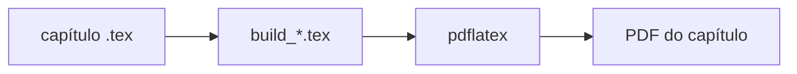

<div class="academic-nav-container">

<div class="academic-nav-breadcrumb">

<span>Projetos Públicos</span> <span class="academic-nav-sep">/</span> <span class="academic-nav-current-leaf">Formulários</span>

</div>

<div class="academic-nav-controls">

<div class="academic-nav-side">

<span class="academic-nav-btn">[[pt-br/projects/personal/devops-guide/index|← Guia de DevOps e Infraestrutura]]</span>

</div>

<div class="academic-nav-center">

<span class="academic-nav-btn">Hub</span> <span class="academic-nav-counter">(6 de 10)</span>

</div>

<div class="academic-nav-side">

<span class="academic-nav-btn">[[pt-br/projects/personal/meu-setup/index|meu-setup →]]</span>

</div>

</div>

</div>

# Formulários

[](https://github.com/pedroiff0/formularios/actions/workflows/ci.yml) [](LICENSE.md) [](https://github.com/pedroiff0/formularios/stargazers) [](#status)

Coleção de folhas de fórmulas e resumos em LaTeX, organizada por disciplina (Cálculo e Física), com um PDF por capítulo e um PDF combinado.

Este projeto faz parte do [portfólio](https://portfolio.phrandrade.com/#formularios) de Pedro Rocha.

## Sumário

- [Resumo](#resumo)
- [Contexto](#contexto)
- [Tecnologias](#tecnologias)
- [Começando](#começando)
- [Como usar](#como-usar)
- [Reprodução dos resultados](#reprodução-dos-resultados)
- [Metodologia](#metodologia)
- [Dados](#dados)
- [Estrutura do repositório](#estrutura-do-repositório)
- [Trabalhando no projeto](#trabalhando-no-projeto)
- [Status](#status)
- [Como citar](#como-citar)
- [Autores](#autores)
- [Licença](#licença)

## Resumo

Folhas de fórmulas costumam ficar espalhadas em cadernos e PDFs de origens diferentes, com notação inconsistente. Este repositório reúne, em LaTeX, as fórmulas das disciplinas de Cálculo e Física do curso, com a mesma configuração visual e um Makefile que gera um PDF por capítulo, um por disciplina e um combinado. Limitação: o conteúdo cobre só as disciplinas já cursadas e não substitui o material do professor.

## Contexto

Material de estudo da graduação em Engenharia de Computação (IFF), mantido para consulta rápida em provas e listas.

### Objetivos

- Padronizar a notação das fórmulas entre capítulos e disciplinas.
- Gerar PDFs de consulta curtos, por capítulo.
- Garantir por CI que todos os capítulos compilam.

## Tecnologias

## Tecnologias


## Começando

### Pré-requisitos

- TeX Live com `pdflatex` e o pacote `siunitx` (Debian/Ubuntu: `texlive-science`).
- `make`.

### Instalação

```bash
git clone https://github.com/pedroiff0/formularios.git
cd formularios
```

### Conferindo que funcionou

```bash
make all
```

Saída esperada: o `main.pdf` é gerado na raiz e os arquivos temporários são removidos.

## Como usar

### Exemplo 1: PDF de uma disciplina

```bash
make fisicas
```

Gera `fisicas/fisicas.pdf`. Para Cálculo: `make calculos`.

### Exemplo 2: PDF de um capítulo

```bash
make fisicaiii cap30
```

### Opções principais

| Opção | Efeito |
| :--- | :--- |
| `FAST=1` | Compila em modo rascunho, uma única passada |
| `VERBOSE=1` | Mostra os passos de cada build |
| `disciplines="calculos,fisicas"` | Gera um PDF por capítulo das disciplinas listadas |

## Reprodução dos resultados

Cada PDF é regenerado por um comando `make`; o CI refaz todos a cada push.

| Resultado | Comando |
| :--- | :--- |
| Um PDF por capítulo | `make disciplines="calculos,fisicas" VERBOSE=1` |
| PDF combinado | `make combined VERBOSE=1` |

## Metodologia

Cada capítulo é um arquivo `.tex` incluído por disciplina. O Makefile monta um arquivo temporário (`build_*.tex`) que inclui só o capítulo pedido, compila com `pdflatex` e apaga os auxiliares.



## Dados

Não há dados externos: o conteúdo é texto LaTeX do próprio repositório.

## Estrutura do repositório

```text
formularios/
├── calculos/      capítulos de Cálculo
├── fisicas/       capítulos de Física
├── animacoes/     figuras animadas
├── latexconfig/   preâmbulo e estilo compartilhados
├── scripts/       utilitários de build
├── main.tex       documento principal
└── Makefile       alvos de compilação
```

## Trabalhando no projeto

### Ambiente de desenvolvimento

```bash
make fisicas-fast
```

### Fluxo de trabalho

1. Crie uma branch a partir de `main`: `git checkout -b feat/<assunto-curto>`.
2. Commits no padrão [Conventional Commits](https://www.conventionalcommits.org/pt-br/).
3. Rode `make combined` antes de abrir o pull request.
4. Registre a mudança na seção `Unreleased` de [CHANGELOG.md](CHANGELOG.md).

### Convenções

Um capítulo por arquivo, notação do preâmbulo em `latexconfig/` e um parágrafo por linha no texto.

## Status

Estado atual: **ativo**. Faltam capítulos das disciplinas dos próximos períodos.

- [x] Cálculo e Física com build por capítulo
- [x] CI que compila todos os capítulos
- [ ] Novas disciplinas

## Como citar

Use o arquivo [CITATION.cff](CITATION.cff) (botão "Cite this repository" do GitHub).

## Autores

## Licença

MIT. Veja [LICENSE](LICENSE.md).

Pedro Henrique Rocha de Andrade, 2026.
