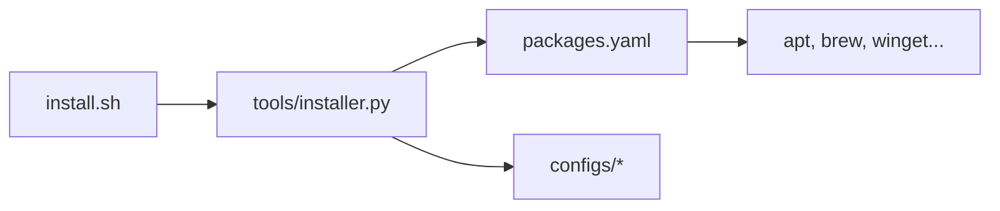

<div class="academic-nav-container">

<div class="academic-nav-breadcrumb">

<span>Projetos Públicos</span> <span class="academic-nav-sep">/</span> <span class="academic-nav-current-leaf">meu-setup</span>

</div>

<div class="academic-nav-controls">

<div class="academic-nav-side">

<span class="academic-nav-btn">[[pt-br/projects/personal/formularios/index|← Formulários]]</span>

</div>

<div class="academic-nav-center">

<span class="academic-nav-btn">Hub</span> <span class="academic-nav-counter">(7 de 10)</span>

</div>

<div class="academic-nav-side">

<span class="academic-nav-btn">[[pt-br/projects/personal/portfolio/index|Portfólio →]]</span>

</div>

</div>

</div>

# meu-setup

[](https://github.com/pedroiff0/meu-setup/actions/workflows/ci.yml) [](https://github.com/pedroiff0/meu-setup/blob/HEAD/LICENSE) [](https://github.com/pedroiff0/meu-setup/stargazers) [](#status-e-próximos-passos)

Instalador declarativo e idempotente do meu ambiente de desenvolvimento para Linux, macOS e Windows: temas, ajustes de sistema para servidor 24/7 e energia, e um catálogo de mais de 100 aplicações.

Este projeto faz parte do [portfólio](https://portfolio.phrandrade.com/#meu-setup) de Pedro Rocha.

## Sumário

- [Por que existe](#por-que-existe)
- [Funcionalidades](#funcionalidades)
- [Tecnologias](#tecnologias)
- [Instalação](#instalação)
- [Como usar](#como-usar)
- [Personalização](#personalização)
- [Como funciona](#como-funciona)
- [Trabalhando no projeto](#trabalhando-no-projeto)
- [Status e próximos passos](#status-e-próximos-passos)
- [Como contribuir](#como-contribuir)
- [Código de conduta](#código-de-conduta)
- [Segurança](#segurança)
- [Suporte](#suporte)
- [Estrelas e atividade](#estrelas-e-atividade)
- [Autor](#autor)
- [Licença](#licença)

## Por que existe

Refazer o ambiente a cada formatação ou máquina nova levava horas e nunca ficava igual. Este repositório descreve o ambiente em `packages.yaml` e nos scripts de `configs/`, e o instalador aplica só o que falta, em qualquer distribuição suportada.

## Funcionalidades

- Instalação por TUI interativa, por packs temáticos (`fullstack`, `devops`, `ai`, `academic`, `creative`, `server_min`) ou pelo catálogo completo.
- Temas: prompt de terminal, WhiteSur, Firefox, Tmux, Starship, Alacritty, Kitty, Windows Terminal e iTerm2.
- Ajustes de sistema: servidor 24/7 (sem suspensão), TCP BBR, limites de inotify, Docker em `data-root` separado, TRIM periódico, AdGuard Home e modo bateria para notebooks.
- Gerenciadores nativos: `apt`, `dnf`, `pacman`, `zypper`, `flatpak`, `snap`, `brew` e `winget`.
- Diagnóstico do sistema e desinstalador que reverte temas e configurações.

## Tecnologias

    

## Instalação

### Pré-requisitos

- Linux (Debian/Ubuntu, Fedora, Arch, openSUSE), macOS ou Windows 11 com winget.
- `curl`, `git` e Python 3.

### Passos

```bash
git clone https://github.com/pedroiff0/meu-setup.git
cd meu-setup
./install.sh
```

Instalação direta:

```bash
bash <(curl -fsSL https://raw.githubusercontent.com/pedroiff0/meu-setup/main/install.sh)
```

### Conferindo

```bash
./install.sh --diagnostico
```

Saída esperada: sistema detectado, gerenciador de pacotes, estado do BBR, da suspensão e do hardware.

## Como usar

### Uso básico

```bash
./install.sh
```

A TUI detecta a distribuição e abre o menu (setas para mover, espaço para marcar, Enter para avançar).

### Exemplos

| Quero | Comando |
| :--- | :--- |
| Aplicar todos os temas | `./install.sh --themes` |
| Aplicar ajustes de sistema | `./install.sh --tweaks` |
| Instalar um pack | `python3 tools/installer.py --pack fullstack` |
| Modo servidor 24/7 | `bash configs/power/server-24-7.sh` |
| Ajustes de rede | `bash configs/network/apply-sysctl-tuning.sh` |

## Personalização

| Opção | Onde | Padrão | O que muda |
| :--- | :--- | :--- | :--- |
| Pacotes e packs | `packages.yaml` | catálogo completo | O que o instalador oferece |
| Ajustes de energia | `configs/power/` | desligados | Suspensão, tampa, TLP |
| Rede e kernel | `configs/network/` | desligados | BBR e sysctl |

## Como funciona

O `install.sh` detecta o sistema, prepara o Python e chama o instalador (`tools/installer.py`), que lê `packages.yaml` e usa o gerenciador de pacotes certo para cada item. Cada ajuste é um script idempotente em `configs/`, que verifica o estado antes de alterar.



## Trabalhando no projeto

```bash
bash -n install.sh
python3 -m pytest
```

1. Crie uma branch a partir de `main`: `git checkout -b feat/<assunto-curto>`.
2. Commits no padrão [Conventional Commits](https://www.conventionalcommits.org/pt-br/).
3. Rode os testes antes de abrir o pull request.
4. Registre a mudança na seção `Unreleased` de [CHANGELOG.md](https://github.com/pedroiff0/meu-setup/blob/HEAD/CHANGELOG).

## Status e próximos passos

Estado atual: **ativo** (versão 2.0.0). Linux é a plataforma mais testada; macOS e Windows seguem o mesmo catálogo com cobertura menor.

- [x] TUI, packs temáticos e catálogo multi-sistema
- [x] Temas e ajustes de servidor 24/7
- [ ] Mais testes automatizados dos scripts de `configs/`

## Como contribuir

Contribuições são bem-vindas. Antes de começar, leia o [guia de contribuição](https://github.com/pedroiff0/meu-setup/blob/HEAD/CONTRIBUTING).

1. Abra uma issue descrevendo o problema ou a ideia.
2. Crie uma branch a partir de `main`: `git checkout -b feat/<assunto-curto>`.
3. Faça commits no padrão [Conventional Commits](https://www.conventionalcommits.org/pt-br/).
4. Abra o pull request e registre a mudança em [CHANGELOG.md](https://github.com/pedroiff0/meu-setup/blob/HEAD/CHANGELOG).

## Código de conduta

Este projeto adota o [Código de Conduta](https://github.com/pedroiff0/meu-setup/blob/HEAD/CODE_OF_CONDUCT). Ao participar, você concorda em segui-lo.

## Segurança

Não abra issue pública para vulnerabilidades. Siga o procedimento de [SECURITY.md](https://github.com/pedroiff0/meu-setup/blob/HEAD/SECURITY) para reportar de forma confidencial.

## Suporte

Dúvidas e pedidos de ajuda: veja [SUPPORT.md](https://github.com/pedroiff0/meu-setup/blob/HEAD/SUPPORT).

## Estrelas e atividade

[](https://star-history.com/#pedroiff0/meu-setup&Date)

[](https://github.com/pedroiff0/meu-setup/graphs/commit-activity) [](https://github.com/pedroiff0/meu-setup/commits) [](https://github.com/pedroiff0/meu-setup/issues) [](https://github.com/pedroiff0/meu-setup/pulls)

## Autor

<table>
  <tr>
    <td align="center"><a href="https://github.com/pedroiff0"><br /><sub><b>Pedro Henrique Rocha de Andrade</b></sub></a><br />Autor e mantenedor</td>
  </tr>
</table>

### Contribuidores

[](https://github.com/pedroiff0/meu-setup/graphs/contributors)

## Licença

Distribuído sob a licença MIT. Texto completo do arquivo [LICENSE](https://github.com/pedroiff0/meu-setup/blob/HEAD/LICENSE):

```txt
MIT License

Copyright (c) 2026 Pedro Henrique Ribeiro de Andrade

Permission is hereby granted, free of charge, to any person obtaining a copy
of this software and associated documentation files (the "Software"), to deal
in the Software without restriction, including without limitation the rights
to use, copy, modify, merge, publish, distribute, sublicense, and/or sell
copies of the Software, and to permit persons to whom the Software is
furnished to do so, subject to the following conditions:

The above copyright notice and this permission notice shall be included in all
copies or substantial portions of the Software.

THE SOFTWARE IS PROVIDED "AS IS", WITHOUT WARRANTY OF ANY KIND, EXPRESS OR
IMPLIED, INCLUDING BUT NOT LIMITED TO THE WARRANTIES OF MERCHANTABILITY,
FITNESS FOR A PARTICULAR PURPOSE AND NONINFRINGEMENT. IN NO EVENT SHALL THE
AUTHORS OR COPYRIGHT HOLDERS BE LIABLE FOR ANY CLAIM, DAMAGES OR OTHER
LIABILITY, WHETHER IN AN ACTION OF CONTRACT, TORT OR OTHERWISE, ARISING FROM,
OUT OF OR IN CONNECTION WITH THE SOFTWARE OR THE USE OR OTHER DEALINGS IN THE
SOFTWARE.
```

---

<div align="center">

 *"Keep looking up."*


<br>

<sub>© 2026 Pedro Rocha — Computer Engineering & Computational Astrophysics · IFF / PIBIC-CNPq, made with ☕, code and ☄️ by Pedro Henrique Rocha de Andrade</sub>

</div>
