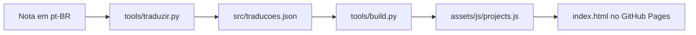

<div class="academic-nav-container">

<div class="academic-nav-breadcrumb">

<span>Projetos Públicos</span> <span class="academic-nav-sep">/</span> <span class="academic-nav-current-leaf">Portfólio</span>

</div>

<div class="academic-nav-controls">

<div class="academic-nav-side">

<span class="academic-nav-btn">[[pt-br/projects/personal/meu-setup/index|← meu-setup]]</span>

</div>

<div class="academic-nav-center">

<span class="academic-nav-btn">Hub</span> <span class="academic-nav-counter">(8 de 10)</span>

</div>

<div class="academic-nav-side">

<span class="academic-nav-btn">[[pt-br/projects/professional/projeto-profissional/index|Projeto Profissional (template) →]]</span>

</div>

</div>

</div>

# Portfolio

[](https://github.com/pedroiff0/portfolio/actions/workflows/ci.yml) [](LICENSE.md) [](https://github.com/pedroiff0/portfolio/stargazers) [](#roadmap)

Portfólio de Pedro Rocha: página estática única, minimalista, com tema claro e escuro e seis idiomas (PT, EN, ES, FR, IT, ZH), publicada no GitHub Pages em [portfolio.phrandrade.com](https://portfolio.phrandrade.com).

## Sumário

- [O que é](#o-que-é)
- [Tecnologias](#tecnologias)
- [Começando](#começando)
- [Como usar](#como-usar)
- [Configuração](#configuração)
- [Implantação](#implantação)
- [Arquitetura](#arquitetura)
- [Trabalhando no projeto](#trabalhando-no-projeto)
- [Roadmap](#roadmap)
- [Suporte](#suporte)
- [Segurança](#segurança)
- [Contribuindo](#contribuindo)
- [Autores](#autores)
- [Licença](#licença)

## O que é

O Portfolio apresenta trajetória, formação (Engenharia de Computação, IFF), pesquisa (PIBIC/CNPq), projetos, eventos e currículo numa página só, sem framework e sem etapa de build no navegador. Não é um blog nem um gerenciador de conteúdo: o conteúdo vem de uma nota em português e é traduzido por script.

### Funcionalidades

- Seções: sobre, destaques, trabalhos (todos os repositórios, com filtro por categoria e busca), pesquisa, bolsas, eventos, currículo, Lattes e contato.
- Topbar com busca (Ctrl/Cmd+K), relógio UTC-3, seletor de idioma e de tema, e modo leitura (`r`).
- Tours em vídeo dos projetos, gravados com Playwright.
- Currículo com prévia da primeira página no idioma da página.

## Tecnologias

## Tecnologias


## Começando

### Pré-requisitos

- Node.js 20 ou superior (testes com Playwright).
- Python 3 (ferramentas em `tools/`).
- `make`.

### Instalação

```bash
git clone https://github.com/pedroiff0/portfolio.git
cd portfolio
npm install
```

### Primeira execução

```bash
make dev
```

### Conferindo que funcionou

```bash
npm test
```

Saída esperada: o teste de fumaça (`tests/smoke.js`) termina sem falhas.

## Como usar

### Tarefa 1: ver o site localmente

1. Rode `make dev`.
2. Abra `http://localhost:8080`.

### Tarefa 2: gravar o tour de um projeto

1. Rode `node tools/record_demos.js <slug>` (sem argumento grava todos).
2. O vídeo (`tour.webm`) e o `poster.webp` saem em `assets/media/<slug>/`.

### Comandos disponíveis

| Comando | Descrição |
| :--- | :--- |
| `make dev` | Servidor local na porta 8080 |
| `make test` | Teste de interface com Playwright |
| `make lint` | Confere arquivos obrigatórios e sintaxe JS |
| `make cv` | Regera as prévias da primeira página dos currículos |
| `make traduzir` | Traduz os trechos pt-BR que mudaram |
| `make publicar-local` | Sincroniza a fonte, traduz se marcado, gera `projects.js` e testa |

## Configuração

| Variável ou arquivo | Padrão | Para que serve |
| :--- | :--- | :--- |
| `PORTFOLIO_FONTE` | nota de conteúdo do vault | Caminho da fonte em português |
| `src/interface.yaml` | rótulos em seis idiomas | Menu e títulos de seção |
| `src/traducoes.json` | gerado | Traduções por trecho, com hash do original |
| `CNAME` | `portfolio.phrandrade.com` | Domínio do GitHub Pages |

## Implantação

O site é estático: `index.html`, `assets/` e `CNAME` vão direto para o GitHub Pages a partir de `master`. Antes de publicar, rode `make publicar-local` e revise o resultado.

### Atualizando

```bash
make publicar-local
git push origin master
```

### Desfazendo uma atualização

```bash
git revert <commit>
git push origin master
```

## Arquitetura

```text
index.html              esqueleto semântico, uma section por área
assets/css/style.css    tokens do quartz-site, claro e escuro
assets/js/projects.js   dados (gerado por tools/build.py, não editar)
assets/js/main.js       render, idioma, tema, filtro, busca e navegação
src/                    conteúdo, traduções e rótulos
tools/                  build, tradução, eventos e gravação de tours
tests/smoke.js          teste Playwright
```



A versão 1 (HUD sci-fi) está na tag `v1-scifi`.

## Trabalhando no projeto

```bash
npm install
make lint
npm test
```

1. Crie uma branch a partir de `master`: `git checkout -b feat/<assunto-curto>`.
2. Commits no padrão [Conventional Commits](https://www.conventionalcommits.org/pt-br/).
3. Edite o conteúdo só em português; as demais línguas saem do script de tradução.
4. Registre a mudança na seção `Unreleased` de [CHANGELOG.md](CHANGELOG.md).

## Roadmap

- [x] Página única com seis idiomas e tema claro e escuro
- [x] Tradução por trecho e tours em vídeo
- [ ] Prévias dos currículos regeneradas automaticamente a cada mudança
- [ ] Mais eventos na linha do tempo

## Suporte

Veja [SUPPORT.md](SUPPORT.md).

## Segurança

Veja [SECURITY.md](SECURITY.md).

## Contribuindo

Veja [CONTRIBUTING.md](CONTRIBUTING.md) e [CODE_OF_CONDUCT.md](CODE_OF_CONDUCT.md).

## Autores

<table>
  <tr>
    <td align="center"><a href="https://github.com/pedroiff0"><br /><sub><b>Pedro Henrique Rocha de Andrade</b></sub></a><br />Autor e mantenedor</td>
  </tr>
</table>

### Contribuidores

[](https://github.com/pedroiff0/portfolio/graphs/contributors)

## Licença

MIT. Veja [LICENSE](LICENSE.md).

Pedro Henrique Rocha de Andrade, 2026.
