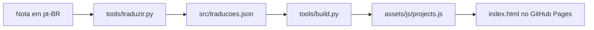

<div class="academic-nav-container">

<div class="academic-nav-breadcrumb">

<span>Projetos Públicos</span> <span class="academic-nav-sep">/</span> <span class="academic-nav-current-leaf">Portfólio</span>

</div>

<div class="academic-nav-controls">

<div class="academic-nav-side">

<span class="academic-nav-btn">[[pt-br/projects/personal/meu-setup/index|← meu-setup]]</span>

</div>

<div class="academic-nav-center">

<span class="academic-nav-btn">Hub</span> <span class="academic-nav-counter">(8 de 10)</span>

</div>

<div class="academic-nav-side">

<span class="academic-nav-btn">[[pt-br/projects/professional/projeto-profissional/index|Projeto Profissional (template) →]]</span>

</div>

</div>

</div>

# Portfolio

[](https://github.com/pedroiff0/portfolio/actions/workflows/ci.yml) [](https://github.com/pedroiff0/portfolio/blob/HEAD/LICENSE) [](https://github.com/pedroiff0/portfolio/stargazers) [](#roadmap)

Portfólio de Pedro Rocha: página estática única, minimalista, com tema claro e escuro e seis idiomas (PT, EN, ES, FR, IT, ZH), publicada no GitHub Pages em [portfolio.phrandrade.com](https://portfolio.phrandrade.com).

## Sumário

- [O que é](#o-que-é)
- [Tecnologias](#tecnologias)
- [Começando](#começando)
- [Como usar](#como-usar)
- [Configuração](#configuração)
- [Implantação](#implantação)
- [Arquitetura](#arquitetura)
- [Trabalhando no projeto](#trabalhando-no-projeto)
- [Roadmap](#roadmap)
- [Como contribuir](#como-contribuir)
- [Código de conduta](#código-de-conduta)
- [Segurança](#segurança)
- [Suporte](#suporte)
- [Estrelas e atividade](#estrelas-e-atividade)
- [Autor](#autor)
- [Licença](#licença)

## O que é

O Portfolio apresenta trajetória, formação (Engenharia de Computação, IFF), pesquisa (PIBIC/CNPq), projetos, eventos e currículo numa página só, sem framework e sem etapa de build no navegador. Não é um blog nem um gerenciador de conteúdo: o conteúdo vem de uma nota em português e é traduzido por script.

### Funcionalidades

- Seções: sobre, destaques, trabalhos (todos os repositórios, com filtro por categoria e busca), pesquisa, bolsas, eventos, currículo, Lattes e contato.
- Topbar com busca (Ctrl/Cmd+K), relógio UTC-3, seletor de idioma e de tema, e modo leitura (`r`).
- Tours em vídeo dos projetos, gravados com Playwright.
- Currículo com prévia da primeira página no idioma da página.

## Tecnologias

      

## Começando

### Pré-requisitos

- Node.js 20 ou superior (testes com Playwright).
- Python 3 (ferramentas em `tools/`).
- `make`.

### Instalação

```bash
git clone https://github.com/pedroiff0/portfolio.git
cd portfolio
npm install
```

### Primeira execução

```bash
make dev
```

### Conferindo que funcionou

```bash
npm test
```

Saída esperada: o teste de fumaça (`tests/smoke.js`) termina sem falhas.

## Como usar

### Tarefa 1: ver o site localmente

1. Rode `make dev`.
2. Abra `http://localhost:8080`.

### Tarefa 2: gravar o tour de um projeto

1. Rode `node tools/record_demos.js <slug>` (sem argumento grava todos).
2. O vídeo (`tour.webm`) e o `poster.webp` saem em `assets/media/<slug>/`.

### Comandos disponíveis

| Comando | Descrição |
| :--- | :--- |
| `make dev` | Servidor local na porta 8080 |
| `make test` | Teste de interface com Playwright |
| `make lint` | Confere arquivos obrigatórios e sintaxe JS |
| `make cv` | Regera as prévias da primeira página dos currículos |
| `make traduzir` | Traduz os trechos pt-BR que mudaram |
| `make publicar-local` | Sincroniza a fonte, traduz se marcado, gera `projects.js` e testa |

## Configuração

| Variável ou arquivo | Padrão | Para que serve |
| :--- | :--- | :--- |
| `PORTFOLIO_FONTE` | nota de conteúdo do vault | Caminho da fonte em português |
| `src/interface.yaml` | rótulos em seis idiomas | Menu e títulos de seção |
| `src/traducoes.json` | gerado | Traduções por trecho, com hash do original |
| `CNAME` | `portfolio.phrandrade.com` | Domínio do GitHub Pages |

## Implantação

O site é estático: `index.html`, `assets/` e `CNAME` vão direto para o GitHub Pages a partir de `master`. Antes de publicar, rode `make publicar-local` e revise o resultado.

### Atualizando

```bash
make publicar-local
git push origin master
```

### Desfazendo uma atualização

```bash
git revert <commit>
git push origin master
```

## Arquitetura

```text
index.html              esqueleto semântico, uma section por área
assets/css/style.css    tokens do quartz-site, claro e escuro
assets/js/projects.js   dados (gerado por tools/build.py, não editar)
assets/js/main.js       render, idioma, tema, filtro, busca e navegação
src/                    conteúdo, traduções e rótulos
tools/                  build, tradução, eventos e gravação de tours
tests/smoke.js          teste Playwright
```



A versão 1 (HUD sci-fi) está na tag `v1-scifi`.

## Trabalhando no projeto

```bash
npm install
make lint
npm test
```

1. Crie uma branch a partir de `master`: `git checkout -b feat/<assunto-curto>`.
2. Commits no padrão [Conventional Commits](https://www.conventionalcommits.org/pt-br/).
3. Edite o conteúdo só em português; as demais línguas saem do script de tradução.
4. Registre a mudança na seção `Unreleased` de [CHANGELOG.md](https://github.com/pedroiff0/portfolio/blob/HEAD/CHANGELOG).

## Roadmap

- [x] Página única com seis idiomas e tema claro e escuro
- [x] Tradução por trecho e tours em vídeo
- [ ] Prévias dos currículos regeneradas automaticamente a cada mudança
- [ ] Mais eventos na linha do tempo

## Como contribuir

Contribuições são bem-vindas. Antes de começar, leia o [guia de contribuição](https://github.com/pedroiff0/portfolio/blob/HEAD/CONTRIBUTING).

1. Abra uma issue descrevendo o problema ou a ideia.
2. Crie uma branch a partir de `main`: `git checkout -b feat/<assunto-curto>`.
3. Faça commits no padrão [Conventional Commits](https://www.conventionalcommits.org/pt-br/).
4. Abra o pull request e registre a mudança em [CHANGELOG.md](https://github.com/pedroiff0/portfolio/blob/HEAD/CHANGELOG).

## Código de conduta

Este projeto adota o [Código de Conduta](https://github.com/pedroiff0/portfolio/blob/HEAD/CODE_OF_CONDUCT). Ao participar, você concorda em segui-lo.

## Segurança

Não abra issue pública para vulnerabilidades. Siga o procedimento de [SECURITY.md](https://github.com/pedroiff0/portfolio/blob/HEAD/SECURITY) para reportar de forma confidencial.

## Suporte

Dúvidas e pedidos de ajuda: veja [SUPPORT.md](https://github.com/pedroiff0/portfolio/blob/HEAD/SUPPORT).

## Estrelas e atividade

[](https://star-history.com/#pedroiff0/portfolio&Date)

[](https://github.com/pedroiff0/portfolio/graphs/commit-activity) [](https://github.com/pedroiff0/portfolio/commits) [](https://github.com/pedroiff0/portfolio/issues) [](https://github.com/pedroiff0/portfolio/pulls)

## Autor

<table>
  <tr>
    <td align="center"><a href="https://github.com/pedroiff0"><br /><sub><b>Pedro Henrique Rocha de Andrade</b></sub></a><br />Autor e mantenedor</td>
  </tr>
</table>

### Contribuidores

[](https://github.com/pedroiff0/portfolio/graphs/contributors)

## Licença

Distribuído sob a licença MIT. Texto completo do arquivo [LICENSE](https://github.com/pedroiff0/portfolio/blob/HEAD/LICENSE):

```txt
The MIT License (MIT)

Copyright (c) 2016 Michael Rose

Permission is hereby granted, free of charge, to any person obtaining a copy
of this software and associated documentation files (the "Software"), to deal
in the Software without restriction, including without limitation the rights
to use, copy, modify, merge, publish, distribute, sublicense, and/or sell
copies of the Software, and to permit persons to whom the Software is
furnished to do so, subject to the following conditions:

The above copyright notice and this permission notice shall be included in all
copies or substantial portions of the Software.

THE SOFTWARE IS PROVIDED "AS IS", WITHOUT WARRANTY OF ANY KIND, EXPRESS OR
IMPLIED, INCLUDING BUT NOT LIMITED TO THE WARRANTIES OF MERCHANTABILITY,
FITNESS FOR A PARTICULAR PURPOSE AND NONINFRINGEMENT. IN NO EVENT SHALL THE
AUTHORS OR COPYRIGHT HOLDERS BE LIABLE FOR ANY CLAIM, DAMAGES OR OTHER
LIABILITY, WHETHER IN AN ACTION OF CONTRACT, TORT OR OTHERWISE, ARISING FROM,
OUT OF OR IN CONNECTION WITH THE SOFTWARE OR THE USE OR OTHER DEALINGS IN THE
SOFTWARE.
```

---

<div align="center">

 *"Keep looking up."*


<br>

<sub>© 2026 Pedro Rocha — Computer Engineering & Computational Astrophysics · IFF / PIBIC-CNPq, made with ☕, code and ☄️ by Pedro Henrique Rocha de Andrade</sub>

</div>
